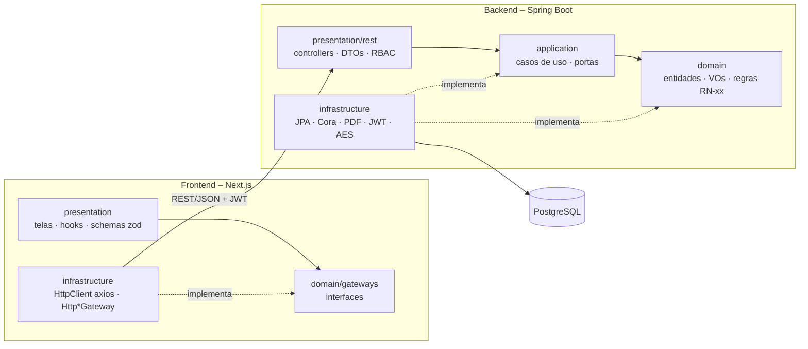

# Semeando Digital

Sistema integrado de gestão escolar do **Centro Educacional Semeando**, construído a partir do
*Levantamento Completo de Requisitos* (PjBL – Programação Orientada a Objetos, UNDB 2026.2).

| Camada        | Tecnologia                                                                 |
|---------------|-----------------------------------------------------------------------------|
| Backend       | Java 21, Spring Boot 4, Spring Security (JWT), Spring Data JPA, Flyway      |
| Banco         | PostgreSQL 17 (Docker)                                                       |
| Frontend      | Next.js 16 (App Router), TypeScript, Tailwind CSS 4, shadcn/ui (Base UI)    |
| Formulários   | react-hook-form + zod                                                        |
| Gráficos      | recharts                                                                     |
| Qualidade     | Biome (lint/format), commitlint + Husky (Conventional Commits)              |
| Testes        | JUnit 5 + Mockito + MockMvc (API) · Vitest + Testing Library · Playwright  |

---

## Como rodar

Pré-requisitos: Java 21, Node 22 + pnpm, Docker.

```bash
pnpm install                    # instala husky/commitlint e ativa os hooks
docker compose up -d db         # PostgreSQL em localhost:5432

cd backend && ./mvnw spring-boot:run          # API em http://localhost:8080/api
cd frontend && pnpm install && pnpm dev       # Web em http://localhost:3000
```

Stack completa em containers: `docker compose --profile app up -d --build`.

> Sem Docker? `cd backend && ./mvnw spring-boot:test-run` sobe a API com H2 em memória.

### Usuários sintéticos (RN-08)

Na primeira execução o sistema carrega **apenas dados sintéticos**, percorrendo os próprios casos de uso
(matrícula → contrato → pagamento → cobrança). Senha de todos: **`Semeando@2026`**.

| E-mail                       | Perfil        |
|------------------------------|---------------|
| `admin@semeando.dev`         | Administrador |
| `diretora@semeando.dev`      | Diretor       |
| `secretaria@semeando.dev`    | Secretaria    |
| `financeiro@semeando.dev`    | Financeiro    |
| `professora@semeando.dev`    | Professor     |
| `responsavel@semeando.dev`   | Responsável   |
| `prestador@semeando.dev`     | Prestador     |

O formulário público de pré-matrícula fica em `/pre-matricula`.

---

## Arquitetura

Clean Architecture organizada em camadas. As dependências apontam sempre para dentro: o **domínio**
não conhece Spring, JPA nem HTTP.



### Backend (`backend/src/main/java/br/org/semeando/digital`)

```
domain/            Regras de negócio puras (sem framework)
  shared/          Cpf, Dinheiro, MesReferencia, IdentidadeInstitucional (RN-09)
  aluno/ matricula/ turma/ pessoa/ contrato/ cobranca/ pedagogico/ obrigacao/ material/ ...
  */XxxRepository  Portas de persistência
application/       Casos de uso (@CasoDeUso) + portas de saída (CoraGateway, NotificacaoGateway…)
infrastructure/
  persistence/     Entidades JPA separadas do domínio + adapters dos repositórios
  gateway/         Cora (fake/http), notificação, armazenamento de arquivos, PDF (OpenPDF)
  security/        JWT (HS256), BCrypt, resolução do Ator autenticado
  config/          Composição (beans), transações dos casos de uso, scheduler, seed sintético
presentation/rest/ Controllers REST, DTOs, tratamento global de erros, perfis (RBAC)
```

* **POO**: herança (`Pessoa` → `Responsavel`, `Professor`, `Funcionario`), hierarquia **selada**
  `DocumentoVinculo` → `FichaSocio` | `ContratoPrestacaoServicos` (RN-01 garantida pelo compilador),
  value objects imutáveis (`record`), enums com comportamento (`TipoDocumento`, `TipoObrigacao`).
* A camada de aplicação não depende do Spring: a anotação própria `@CasoDeUso` é registrada pela
  infraestrutura, que envolve cada caso de uso em uma transação (`CasoDeUsoConfig`).

### Frontend (`frontend/src`)

```
domain/models      Tipos do domínio
domain/gateways    Contratos (interfaces) – ex.: MatriculaGateway.aprovar(id)
infrastructure/    HttpClient (interface) → AxiosHttpClient; Http*Gateway; container de DI
presentation/      Providers (Gateway/Auth), hooks (useCarregar/useAcao), telas por módulo, schemas zod
app/               Rotas do Next (finas – apenas montam as telas)
components/ui      Componentes shadcn/ui
```

**Nenhum componente faz requisição diretamente** (sem `fetch`/axios nas telas): as telas chamam
métodos de gateway obtidos por `useGateways()`, e só a infraestrutura conhece o transporte HTTP.

---

## Rastreabilidade dos requisitos

| Módulo | Requisitos | Onde está |
|---|---|---|
| 1 – Matrícula | RF-01 a RF-12 | `SolicitarPreMatriculaUseCase`, `AnalisarMatriculaUseCase`, `GerenciarMatriculaUseCase`, `RenovarMatriculaUseCase`, `ConsultarMatriculasUseCase` · telas `/pre-matricula`, `/matriculas` |
| 2 – Contratos | RF-13 a RF-18 | `GeradorDocumentoVinculo`, `ContratosUseCase` (assinatura com IP + SHA-256, versionamento) · `/contratos` |
| 3 – Materiais | RF-05, RF-19 a RF-22 | `ListaMateriaisUseCase` (publicação, arquivamento, notificação, PDF) · `/materiais`, portal |
| 4 – Cobrança/Cora | RF-23 a RF-30 | `GerarCobrancasMensaisUseCase`, `ConfirmarPagamentoUseCase` (webhook + manual + recibo), `ConsultarFinanceiroUseCase` · `/financeiro` |
| 5 – Cadastros | RF-31 a RF-38 | `AlunosUseCase`, `ProfessoresUseCase`, `FuncionariosUseCase`, `PrestadoresUseCase`, `BuscaUnificadaUseCase`, `Auditor` · `/alunos`, `/cadastros`, busca no topo |
| 6 – Pedagógico | RF-39 a RF-46 | `PlanosAulaUseCase`, `DiarioClasseUseCase`, `PlanejamentoCalendarioUseCase` · `/pedagogico` |
| 7 – Obrigações | RF-47 a RF-54 | `ObrigacoesUseCase`, `VerificarAlertasObrigacoesUseCase` (agendado), `ExportacaoRegulatoriaUseCase` (CSV Censo/Presença) · `/obrigacoes` |

| Regra | Implementação |
|---|---|
| RN-01 | `TipoVinculo.para(nivel)` + hierarquia selada + `validarCompatibilidade` |
| RN-02 | `TabelaValores` (R$ 375,00 × 11 = R$ 4.125,00); configuração divergente impede a aplicação de subir |
| RN-03 | `CalculadoraEncargos` – multa 2% + juros 0,033%/dia |
| RN-04 | `MatriculaContexto.garantirMatriculaUnica` + transferência gera histórico |
| RN-05 | `TipoDocumento.exigidosPara(nivel)` – 7 documentos por nível |
| RN-06 | `ContratoPrestacaoServicos` exige hospital e autorizados (também validado no front) |
| RN-07 | `PoliticaEmissaoBoleto` |
| RN-08 | `DadosSinteticosSeeder` + CPFs sintéticos nos testes |
| RN-09 | `IdentidadeInstitucional` validada na inicialização e impressa nos documentos |
| RN-10 | `TipoObrigacao.prazo()` + alertas de 30/15 dias sem repetição |

Requisitos não funcionais atendidos: RBAC por perfil (RF-35), log de auditoria somente inserção, com
trigger no PostgreSQL que bloqueia UPDATE/DELETE (RNF-06), criptografia AES-256-GCM das informações de
saúde em repouso (RNF-01), registros nunca excluídos (RF-37), interface responsiva (RNF-04),
cobertura de testes do backend de 70,4% (RNF-05, relatório em `backend/target/site/jacoco`).

---

## Testes

```bash
cd backend && ./mvnw test        # domínio + casos de uso + E2E da API (MockMvc/H2) + JaCoCo
cd backend && ./mvnw verify      # inclui PostgresMigracoesIT (Testcontainers – requer Docker)
cd frontend && pnpm test         # Vitest: gateways, schemas, componentes
cd frontend && pnpm test:e2e     # Playwright: navegador → Next → API (sobe tudo sozinho)
```

## Commits

Conventional Commits obrigatório (`feat(matricula): …`). Hooks do Husky:
`commit-msg` → commitlint · `pre-commit` → lint + typecheck do front ·
`pre-push` → lint, typecheck e testes do front + testes do backend.

---

## Premissas e pendências

Premissas adotadas onde o levantamento não define valores:

* Taxa de associado (R$ 280,00) e taxa de matrícula (R$ 150,00) são **valores de exemplo**, configuráveis
  em `application.yml` (`semeando.valores`).
* O checklist de 7 documentos por nível (`TipoDocumento`) e as validades usadas na renovação são uma proposta.
* Bimestres do Sistema Presença: fev–mar, abr–mai, ago–set, out–nov.

Ainda não implementado:

* **2FA para administradores (RNF-01)**.
* Envio real de e-mail/WhatsApp: o `LogNotificacaoGateway` apenas registra a mensagem; falta um
  adaptador SMTP / WhatsApp Business.
* Integração Cora em produção: o `CoraHttpGateway` existe, mas falta o certificado mTLS e a validação do
  payload contra a API real. Por padrão roda o `CoraFakeGateway`.
* Testes de carga (RNF-02) e monitoramento de uptime (RNF-03).
